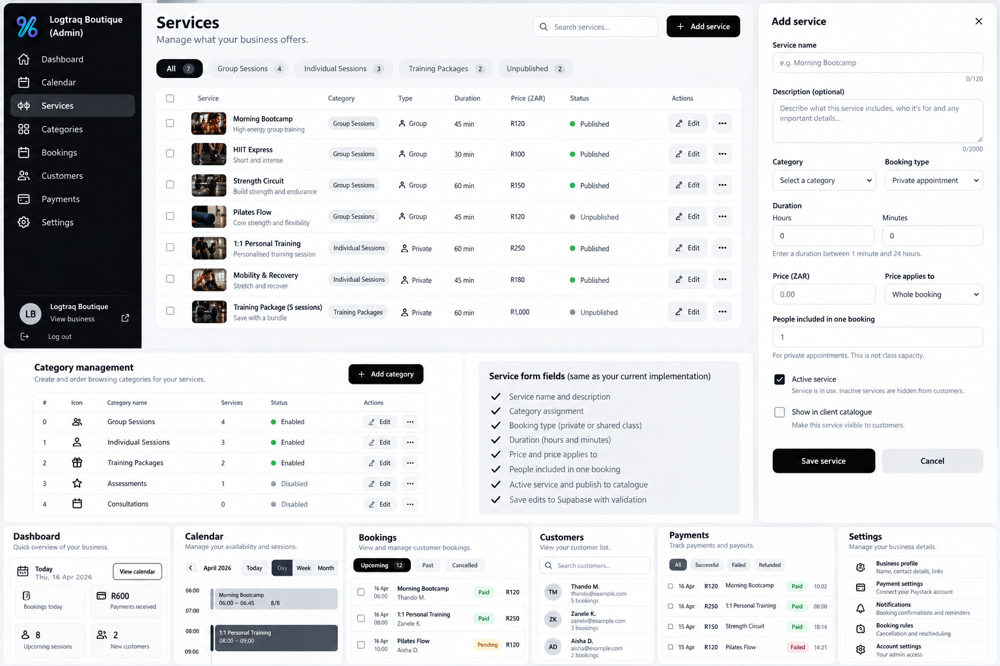

# Admin interface visual reference

Saved 2026-10-30 from the owner's original admin.png attachment. This is the important, detailed visual target for the future admin interface. The original PNG is preserved without resizing or editing.

## Implemented admin stage — 2026-10-30

The owner approved a dedicated Categories screen and workspace/sidebar cleanup. Admin now has a dark sidebar with Calendar, Services and Categories, actual business identity, a safe public View business link, compact header/contact links and responsive navigation.

Categories has an order/icon/name/service-count/status/Edit table with Add/Edit forms and dedicated save/loading/error/reload feedback, backed by the existing Supabase RPCs. Counts reflect actual saved service assignments, including unpublished/inactive offerings. Services keeps its existing cards and working form/category selector. Navigation preserves calendar state and drafts; notices explain edits open in another section.

This stage does not implement the pictured Services table, search/filter chips, drawer, bulk/row menus or extra admin modules. No schema/business-data changes. Browser verification remains outstanding; see the newest handoff for tested behaviour and the next agreed step.

## What the image establishes

- A dark left sidebar with the business identity, clear active-section highlight and readable icons/labels.
- A neutral Services workspace with a heading, service search, Add service action and category/publication filters.
- A compact service table showing service name/description, optional supplied photo, category, booking type, duration, configured ZAR price, publication status and edit actions.
- A right-side Add/Edit service drawer with labelled fields, validation/help, Active and catalogue-publication controls, Save and Cancel.
- Category management showing display order, icon, category name, associated-service count, enabled state and edit actions.
- A consistent neutral black/white/grey control system, clear spacing and typography, with business branding kept separate.
- Bottom panels describe the future Dashboard, Calendar, Bookings, Customers, Payments and Settings directions. They are parts of the design reference, not current working product screens.

## What works today

Admin currently has Calendar, Services and Categories navigation in the new sidebar. Categories has a dedicated management table and inline Add/Edit form; Services has a card-based service list and inline Add/Edit form. The pictured Services table/drawer and extra modules remain future work.

Category settings are saved to public.service_categories in Supabase: business ownership, ID, label, allowlisted icon identifier, enabled flag, sort order and timestamps. Admin can create/edit categories; there is no category-delete action. Only enabled categories containing at least one published active service appear to customers.

Services are saved to public.services. The form supports:
1. Service name, up to 120 characters.
2. Optional description, up to 2,000 characters.
3. One category assignment; unassigned drafts are allowed, but publishing requires an owned category.
4. Booking type: private appointment or shared class.
5. Duration in hours/minutes, saved as total minutes between 1 and 1,440.
6. Fixed ZAR price, saved as integer cents.
7. Whole-booking or per-person pricing; shared classes use per-person pricing.
8. Fixed people included in a private booking; this is not shared-class capacity.
9. Active service, independent from publication.
10. Show in client catalogue, requiring active service and enabled category for public visibility.
11. Save/Cancel, edit, reload, validation, lost-create-response retry protection and stale-edit protection.

New services default to Active but unpublished. Disabling a category hides its services publicly without deleting them. Existing admin-link ownership checks remain; Supabase Auth/login/logout has not been implemented.

The customer client now reads saved public categories/services, filters offerings in-page, highlights the selected card and preserves valid service/date/time when browsing categories. Desktop uses category navigation left, cards centre and booking/calendar right; smaller screens use a horizontal category row and stacked booking panel.

## Keep the meaning of the data separate

Category organises browsing. Service is the offering purchased. Booking type determines scheduling/fulfilment rules. Never derive booking type from category labels or copy the screenshot's Group/Private labels into rules without an agreed definition.

The image includes example names, prices, photos, counts, publication indicators, paid bookings, customers and payment/account information. These are illustrative, not actual Logtraq records. The screenshot itself is not a supplied set of service-photo assets. Do not create sample records, extract mockup photos as real offerings, invent class capacity/paid bookings, or treat a session package as an ordinary private appointment.

## Still to agree and implement

- Actual supplied service-photo storage, upload/reference and display.
- The Services table, search, category/publication filters, drawer, row menu and bulk selection/actions. The dedicated Categories page/table is now implemented.
- Any new Dashboard, Bookings, Customers, Payments, Settings or account/login/logout screen.
- Duration-aware private availability and scheduled shared classes/capacity, then reservations and verified service-specific payments, in the established order.
- Package credits/redemption and other future capabilities require separate design and authorization.

Saving this reference is not authorization to implement all pictured capabilities. Work one small agreed step at a time. The Order summary remains paused. Keep the real supplied Paystack destination, disabled service-specific payment, and date/time-only slot acceptance. Actual desktop/mobile browser verification remains outstanding; consult PROJECT_HANDOFF.md before implementation.

Related customer/combined reference: [final visual plan](references/final-visual-plan.png). Current state, release history and next step: [project handoff](PROJECT_HANDOFF.md). Customer catalogue brief: [catalogue redesign](catalogue-redesign.md).
