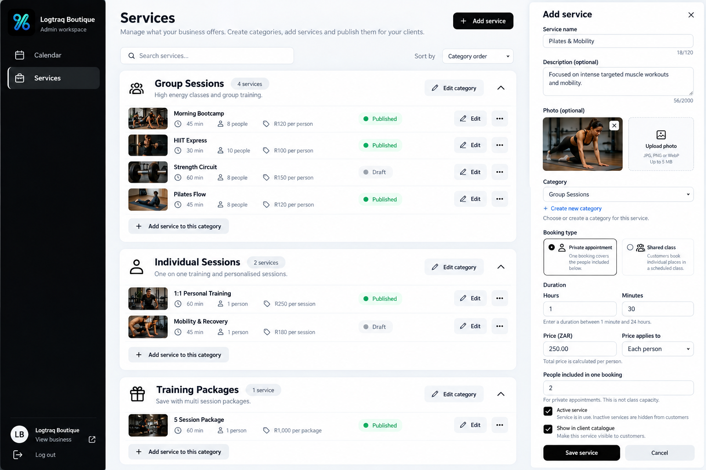

# Admin Services workflow reference — 2026-10-31

The original PNG is saved unchanged (1,470,549 bytes; Git blob 5a8d4157179d29c4c3121774b7b29eefff711504). Original upload: 65401f59-f4fe-45cc-bdd1-1958a64a4f81.png.

## Authorized scope

Services is the only workspace for service AND category management. Remove Categories from the sidebar entirely; only Calendar and Services remain. Keep the existing Supabase category/service schema, saved records, icons/order, photo storage, price calculations, ownership, validation, retry IDs and concurrency protection.

Display actual services under collapsible category headers with name, actual service count and category actions. Include empty/disabled categories for admin management and an actionable section for saved uncategorised drafts. Allow adding a service directly into a category, moving existing services by editing their assignment, and creating/editing/enabling/disabling/reordering categories within Services.

Add/Edit service opens a responsive side panel or modal. Essential fields: name, category, booking type, duration, price, publication. Secondary description/photos/advanced pricing belong in labelled expandable sections. The category dropdown includes + Create new category; its inline modal saves using existing RPCs and assigns the result without discarding the service draft. Handle category-save/service-save partial failures and lost responses without duplicate categories/services.

Use a clear publication action while retaining independent is_active/is_published values and old records. Explain publication blockers next to the relevant field. Distinguish Draft, Published and Not bookable yet. Shared classes remain unbookable pending scheduling/capacity. Existing service-specific payment checkout stays disabled.

Match the black/charcoal/grey/white design, current real logo and responsive sidebar. Customer booking pages remain unchanged. Do not invent the image's example categories, services, prices, people/capacity, photos or packages. Search, sorting controls, overflow menus, logout and package functionality pictured in the reference are not required by this task.

Acceptance: with zero categories, create a service, create its category inside the form, supply details and save/publish without leaving Services.

Work incrementally, verify existing flows and save/deploy completed work. Order summary remains paused; scheduling/capacity → reservations → verified payments retains its order.
