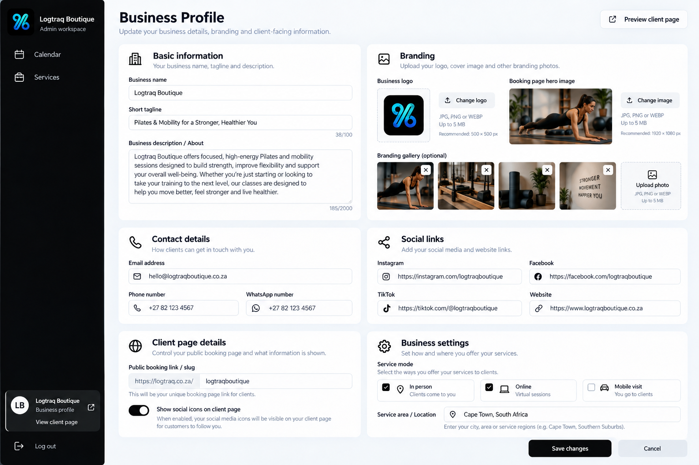

# Business Profile — approved extension

Original: Modern Business Profile Dashboard.png, 1,682,547 bytes, saved unchanged. This is the owner's approved reference for editable Business Profile, following the completed integrated Services workflow. Screenshot names, contacts, photos and sample content are illustrative, never seed business data.

Open Business Profile through a clickable bottom sidebar identity area. Keep Calendar and Services as the only primary navigation items. Separate View client page and Preview client page links open the actual public booking page in a new tab.

Reuse the existing business record, admin-link authorization, neutral design, logo/contact/social fields and credential-checked photo upload infrastructure. Add minimal backwards-compatible profile fields for tagline/about, separate phone/email/website, hero/gallery, social visibility, location/delivery methods and concurrency. Slug remains read-only. Provide previews, 5 MB JPG/PNG/WebP validation, safe URLs, retained input/retry/error/cancel handling and public display of configured fields. No colour extraction, new auth/logout, payment onboarding, service/calendar redesign or invented records.

Implement and verify authorized profile editing end-to-end, save/deploy and update the handoff. Shared classes stay unbookable, service payments disabled, Order summary paused; scheduling/capacity → reservations → verified payments remains the sequence.
